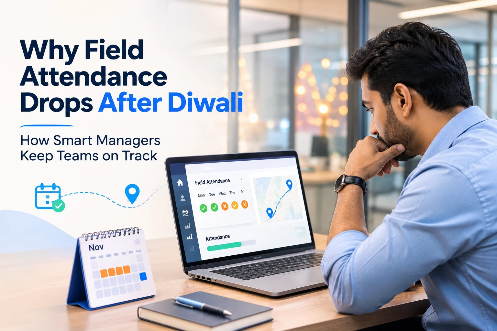

# Why Field Attendance Drops Every Year After Diwali and What Smart Managers Do

It's the Monday after Diwali. Sanjay manages 40 field reps for an FMCG distributor in Gurugram, and at 10 am the attendance report shows just 22 people have punched in.

By noon, the messages start coming in. One rep couldn't get a confirmed train ticket back from Patna. Another is staying home till Chhath. Two have a wedding in the family. A few haven't replied at all.

Meanwhile, retailers across the territory are calling for stock. Their shelves emptied out during the festive rush and they want to restock before wedding season orders begin. Almost half the beats for the week have nobody to cover them.

The strange part is that this happens every single year. The dates move a little, but the pattern doesn't. And yet most companies treat the post Diwali attendance drop as a surprise and deal with it one phone call at a time.

In this blog, we'll look at why field attendance falls after Diwali, what it quietly costs your business and the practical steps smart managers take to stay ahead of it.

## Why Field Attendance Drops After Diwali

There isn't one big reason. It's a handful of small ones that all arrive in the same fortnight.

- **Long journeys home.** Many field reps working in big cities come from Bihar, Uttar Pradesh, Jharkhand and other states. Diwali, Bhai Dooj and Chhath fall within days of each other, so one trip home often covers all three. Trains are packed in this season and a confirmed return ticket can be hard to find.
- **Leave that quietly stretches.** A rep asks for three days off on WhatsApp. The manager says okay. Nobody writes down a return date, and three days slowly becomes ten.
- **Festive fatigue.** From Navratri to Diwali, field teams work long days with heavy order loads. Once the rush is over, many reps are simply tired and take a few extra days to recover.
- **Weddings in the family.** The wedding season starts soon after Diwali, and for many families this is the busiest stretch of the year for functions.
- **Nothing left to chase.** Festive targets are done and the next incentive feels far away, so coming back a few days late doesn't seem to cost much.
- **Weak attendance records.** When attendance lives in a register or a group chat, nobody really knows who is back, who is on leave and who is just not answering. Sometimes a colleague marks someone present as a favour.

None of these is unusual on its own. Together, they create a gap that can drag on for two or three weeks.

## What the Post Diwali Gap Really Costs

It's tempting to see this as a few lost working days. The real cost is much bigger.

- **Empty shelves at the worst time.** Retailers sold through their stock during Diwali. If your rep doesn't visit to take the restock order, a competitor's rep will, and that shelf space may not come back easily.
- **Payroll mistakes.** Without clear records, some people get paid for days they didn't work while others face wrong deductions. Both lead to arguments in December.
- **Unfair pressure on the reps who came back.** The ones who returned on time end up covering extra beats with no extra credit. That is exactly how good people start losing motivation.
- **A slow start to November.** Monthly targets begin in a hole, and managers spend the rest of the month trying to catch up.

## What Smart Managers Do Differently

The good news is that a predictable problem can be planned for. Here's what experienced field managers do every festive season.

### 1. They plan festive leave before Diwali, not after

Smart managers collect leave requests in early October. They stagger approvals so every territory has at least one person on the ground through the festive weeks, and every approved leave comes with a clear return date. Using proper [attendance tracking](https://trackolap.com/product/hr-management/attendance-and-leave-management-software) with leave approvals in an app means the plan is written down instead of buried in a chat thread.

### 2. They confirm return dates a week in advance

A short call a week before the planned return works wonders. Has the rep booked a ticket? Is the date still realistic? If someone needs two more days, it's far better to know on Tuesday than to discover it on Monday morning.

### 3. They adjust beats for the gap weeks

Instead of leaving whole routes untouched, smart managers merge beats for a couple of weeks. Not every outlet needs a visit right away. Big and fast moving retailers come first, while smaller outlets can wait a few days. Good [beat planning software](https://trackolap.com/product/sales-crm/beat-planning-software) lets you grade outlets by value and sequence routes by distance, so the reps who are working cover the customers who matter most.

### 4. They know exactly who is back and working

From the first working day after Diwali, attendance should be verified, not assumed. A selfie with a GPS stamped punch in shows who has actually started work and where. During the day, [live employee tracking](https://trackolap.com/product/sales-crm/employee-live-tracking-system) helps managers see which reps are on their routes, so urgent restock calls can go to whoever is nearest. It also puts an end to proxy attendance, which tends to creep in when teams are short staffed.

### 5. They give returning reps a soft restart

Someone stepping off a long, crowded train journey is not going to be at their best on day one. Smart managers plan a lighter first day built around priority restock visits, then bring the rep back to a full beat over the next few days. It's a small gesture, but reps remember it.

### 6. They reward the people who held the fort

The reps who covered extra beats deserve recognition. That can be a small bonus, a shout out in the team meeting or first choice of leave dates next year. Their extra travel should also be paid back quickly. With [expense management](https://trackolap.com/product/sales-crm/expense-management-software) that checks claims against tracked distance, these reimbursements can be approved without delays or doubts.

### 7. They learn from this year's data

Every festive season leaves a trail of data. Which territories had the biggest gaps? How long did attendance take to recover? Which reps returned on time? A [field sales automation](https://trackolap.com/product/sales-crm/field-sales-automation-software) platform that tracks planned versus actual visits makes these questions easy to answer, and next year's festive plan gets better because of it.

## A Quick Post Diwali Attendance Checklist

If Diwali is already here and you haven't planned much, don't worry. These steps still make a real difference in the first week back.

- List every rep with their leave status and expected return date
- Call anyone whose return date is unclear or who hasn't replied
- Mark the top outlets in each territory and assign cover for them
- Switch on verified punch in from the first working day
- Plan a lighter first day for reps coming back from long journeys
- Note down who covered extra beats so you can recognise them later

## A Word on Being Fair

Not every late return is a discipline problem. Trains get cancelled, family members fall ill and some journeys genuinely take longer than planned. The goal of tracking is not to punish people for being human. It's to replace guesswork with a clear picture everyone can see, so that decisions about leave, pay and coverage are fair to all, including the reps who came back on time.

## Final Thoughts

The post Diwali attendance drop is not bad luck. It's as predictable as the monsoon, and it deserves the same kind of planning.

Plan leave early, confirm return dates, adjust beats for the gap weeks and use verified attendance from the first day back. Do that, and the weeks after Diwali stop being a scramble and become a smooth restart into the wedding season and the year end push.

If you want to see how this can work for your team, book a demo with TrackOlap and explore how attendance, beat planning and live tracking fit together.

## Frequently Asked Questions

### Why do field employees take extended leave after Diwali?

Diwali, Bhai Dooj and Chhath fall within a short span, and many field staff travel to their home states for all of them. Crowded trains, family weddings and festive fatigue often stretch a short break into a much longer one.

### When does field attendance usually get back to normal after Diwali?

In many teams it settles within two or three weeks, once Chhath travel is over and people are back from family functions. With a clear leave plan and confirmed return dates, the recovery can be much quicker.

### How can managers reduce absenteeism after festivals?

Plan leave before the festival, set clear return dates, confirm them a week ahead and use verified attendance from the first working day. Small rewards for reps who return on time also help a lot.

### How do you keep sales coverage going when many reps are on leave?

Merge beats for the gap period and put high value and fast moving outlets first. The reps who are working can then focus on the customers that matter most until the full team is back.

### What should a festive leave policy for field teams include?

It should cover how early leave must be requested, how many people from one territory can be away at the same time, how return dates are confirmed and what happens if someone extends leave without approval. Share it with the team well before the festive season starts.

### How can companies stop proxy attendance when teams are short staffed?

Use a mobile punch in that needs a live selfie and records GPS location. That way attendance is linked to the actual person and place, and one rep can't mark another present.
